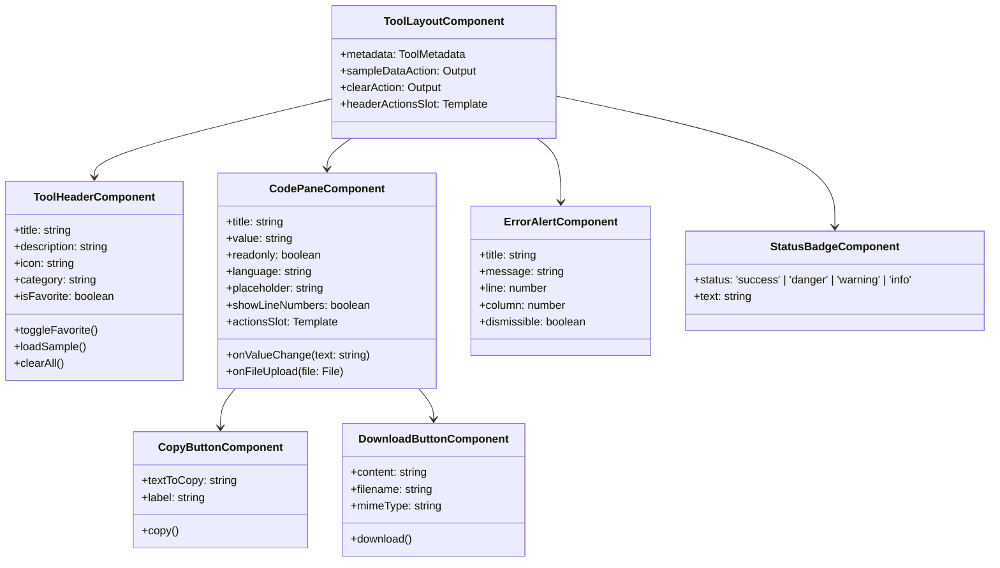

# DevTools Hub — System Architecture Document

## 1. Executive Summary & Architectural Vision

**DevTools Hub** is a client-side, browser-based suite of 12 developer utilities engineered for high performance, uncompromising privacy, and intuitive developer ergonomics. The application processes 100% of inputs within the user's browser, eliminating external server hops, data exfiltration risks, and backend maintenance overhead.

This architecture document defines the structural patterns, state management strategies, component composition models, design tokens, and security boundaries governing the application.

---

## 2. Technology Stack & Environment Evaluation

### 2.1 Workspace & Runtime Audit
- **Operating Environment:** Windows (win32 x64)
- **Node.js Runtime:** v22.17.0 (Active LTS)
- **Package Manager:** npm v10.9.2
- **Angular CLI:** v21.2.6 (Modern Standalone Architecture)
- **Initial Workspace State:** Clean directory; no legacy `AppModule` or pre-existing conflicting configurations.

### 2.2 Core Technical Specifications
| Technology | Role | Version / Specification | Rationale |
| :--- | :--- | :--- | :--- |
| **Angular** | Core Framework | 19.x / 20.x Standalone | Modern signal-based reactivity, standalone components, fine-grained change detection, optimized tree-shaking. |
| **TypeScript** | Primary Language | 5.x (`strict: true`) | Enforces type safety, avoids runtime null/undefined errors, guarantees strict interface compliance. |
| **Tailwind CSS** | Styling System | Latest Stable | Utility-first CSS, automated purge/JIT engine, standardized color tokens, dark mode via CSS class strategy. |
| **Angular Router** | Navigation | Standalone Router with lazy loading | Chunk splitting per tool; sub-second initial bundle load; route guards and title strategies. |
| **Lucide Angular** | Iconography | Official Lucide Icons | Clean, lightweight, consistent SVG icon system with tree-shaking support. |
| **PapaParse** | CSV Parser | 5.x (`papaparse` + `@types/papaparse`) | RFC 4180-compliant CSV parser capable of streaming, handling escaped delimiters, quotes, and newlines safely. |
| **Web Crypto API** | Cryptography | Browser-native `crypto.subtle` & `crypto.randomUUID` | High-performance, cryptographically secure operations without heavy third-party bundle bloat. |
| **LocalStorage** | Persistence | Native Web Storage API | Client-only storage for user preferences (theme, favorites, recent tools); never persists sensitive tool input. |

---

## 3. High-Level System Architecture

```mermaid
graph TD
    subgraph Browser Context [Browser Client Sandbox]
        subgraph Shell [App Shell & Navigation]
            Nav[Navbar & Global Search Ctrl+K]
            Sidebar[Responsive Collapsible Sidebar]
            Theme[Theme Service: Light/Dark]
            Fav[Favorites & Recent Tools Services]
        end

        subgraph Core Registry [Tool Registry Single Source of Truth]
            Registry[ToolRegistryService]
            Metadata[Tool Metadata, Categories, Keywords]
            Registry --> Metadata
        end

        subgraph View Layer [Standalone Angular Components]
            Dashboard[Dashboard View]
            AllTools[All Tools Catalog View]
            FavView[Favorites View]
            AboutView[About & Privacy View]
            ToolViews[12 Lazy-Loaded Tool Pages]
        end

        subgraph Shared UI Layer [Reusable Tool Primitives]
            ToolLayout[Tool Page Container]
            Header[Tool Header & Actions]
            EditorPane[Dual-Pane Code/Text Area]
            CopyBtn[Copy to Clipboard Component]
            DownloadBtn[File Download Component]
            StatusBadge[Validation & State Badges]
            AlertBanner[Error Diagnostics Display]
        end

        subgraph Engine Layer [Pure Functional Tool Engines]
            JsonEngine[JSON Formatter & Validator Engine]
            CsvEngine[CSV/JSON Transformation Engine]
            CryptoEngine[Web Crypto SHA-256 & UUID Engine]
            EncodingEngine[UTF-8 Base64 & URL Engine]
            TokenEngine[JWT Decoding Engine]
            TimeEngine[Timestamp & Epoch Engine]
            RegexEngine[Regex Matching & Profiling Engine]
            CronEngine[Cron Syntax Parser & Builder]
        end

        subgraph Browser Native APIs [Browser Native Platform]
            WebCrypto[crypto.subtle & crypto.randomUUID]
            TextAPI[TextEncoder & TextDecoder]
            Storage[localStorage Preferences]
            Clipboard[navigator.clipboard]
            BlobAPI[Blob & URL.createObjectURL]
        end
    end

    Nav --> Registry
    Sidebar --> Registry
    Dashboard --> Registry
    AllTools --> Registry

    ToolViews --> ToolLayout
    ToolLayout --> Header
    ToolLayout --> EditorPane
    ToolLayout --> CopyBtn
    ToolLayout --> DownloadBtn
    ToolLayout --> StatusBadge
    ToolLayout --> AlertBanner

    ToolViews --> EngineLayer
    EngineLayer --> Browser Native APIs
```

---

## 4. Architectural Patterns & Design Principles

### 4.1 Standalone Component Architecture
The application strictly adopts Angular's modern standalone architecture. No `NgModule` or `app.module.ts` will be introduced. Every component, directive, and pipe declares its dependencies explicitly via its `imports` array.

- **Predictable Dependency Graph:** Eliminates ambiguous multi-module imports.
- **Aggressive Tree-Shaking:** Unused code paths are purged during compilation.
- **Route-Level Code Splitting:** Every tool component is lazy-loaded using `loadComponent: () => import(...)`.

### 4.2 Reactive State Management with Angular Signals
In alignment with modern Angular standards, application and component state is managed using **Angular Signals** (`signal`, `computed`, `effect`) rather than heavy RxJS boilerplate for synchronous state:
- **Zero Zone Overhead:** Signal updates trigger surgical, fine-grained DOM updates without full-tree dirty checking.
- **Derived Computations:** Filtered tools, validation statuses, and search queries use `computed()`, guaranteeing memoized performance.
- **Persistent Synchronization:** Effects (`effect()`) cleanly synchronize state mutations with `localStorage` (e.g., active theme, favorite IDs).

### 4.3 Separation of Concerns: Tool Component vs. Pure Engine
To ensure maintainability, testability, and clarity, each tool is separated into two distinct layers:
1. **Tool Component (Presentation & Interaction):**
   - Manages UI signals (inputs, selected options, output signals, error messages).
   - Coordinates clipboard copying, file download triggers, sample loading, and reset actions.
2. **Pure Functional Service/Utility (Engine):**
   - Headless TypeScript module or service with zero DOM dependencies.
   - Pure functions accepting inputs and options, returning deterministic outputs or throwing structured typed errors.
   - 100% testable via standard unit tests without complex Angular TestBed overhead.

---

## 5. Centralized Tool Registry Architecture

The **Tool Registry** is the canonical metadata authority for the entire application. It governs navigation, category grouping, search indexing, and routing.

### 5.1 Tool Definition Interface
```typescript
export type ToolCategory =
  | 'formatters-validators'
  | 'converters-encoders'
  | 'security-crypto'
  | 'generators-utilities';

export type ToolStatus = 'available' | 'beta' | 'planned';

export interface ToolMetadata {
  id: string;                      // Unique slug (e.g., 'json-formatter')
  name: string;                    // Human-readable title
  description: string;             // Short functional description
  icon: string;                    // Lucide icon identifier
  category: ToolCategory;          // Functional grouping
  route: string;                   // Angular route path (e.g., '/tools/json-formatter')
  keywords: string[];              // Search indexing terms
  status: ToolStatus;              // Readiness state
  featured?: boolean;              // Dashboard spotlight flag
}
```

### 5.2 Category Architecture
The 12 tools are logically grouped into 4 distinct functional categories:

| Category | Identifier | Tools Included |
| :--- | :--- | :--- |
| **Formatters & Validators** | `formatters-validators` | JSON Formatter, JSON Validator |
| **Converters & Encoders** | `converters-encoders` | JSON to CSV, CSV to JSON, Base64 Encoder/Decoder, URL Encoder/Decoder |
| **Security & Cryptography** | `security-crypto` | JWT Decoder, SHA-256 Hash Generator |
| **Generators & Utilities** | `generators-utilities` | UUID Generator, Timestamp Converter, Regex Tester, Cron Builder |

### 5.3 Centralized Tool Registry Service
`ToolRegistryService` provides:
- `tools`: `Signal<ToolMetadata[]>` containing all registered tools.
- `categories`: Metadata list with display names, descriptions, and category icons.
- `search(query: string)`: `Signal<ToolMetadata[]>` computing matching tools against name, description, category, and keyword index.
- `getToolById(id: string)`: Instant lookup for tool metadata.
- `getToolsByCategory(cat: ToolCategory)`: Grouped array for structured views.

---

## 6. Shared Layout & Reusable Component System

To prevent code duplication across the 12 tools, DevTools Hub utilizes a unified UI shell and a robust set of reusable presentation components.



### 6.1 Reusable UI Primitives
1. **`ToolLayoutComponent` (`src/app/shared/components/tool-layout`):**
   Standardizes container margins, responsive flex/grid layouts, breadcrumbs, tool header, and slot projections for inputs, controls, and outputs.
2. **`CodePaneComponent` (`src/app/shared/components/code-pane`):**
   Full-featured editor container providing:
   - Monospace typography (`font-mono`) with soft wrap toggling.
   - Live character count, byte size counter, and line count indicators.
   - Integrated drag-and-drop file upload handler.
   - Reusable action bar slot (Copy, Download, Format, Minify, Clear).
3. **`CopyButtonComponent` (`src/app/shared/components/copy-button`):**
   Uses `navigator.clipboard.writeText` with safe fallback; shows a transition from clipboard icon to green checkmark with "Copied!" tooltip for 2000ms.
4. **`DownloadButtonComponent` (`src/app/shared/components/download-button`):**
   Creates a temporary `Blob` and synthetic anchor click (`URL.createObjectURL(blob)`) to reliably trigger downloads without server involvement.
5. **`ErrorAlertComponent` (`src/app/shared/components/error-alert`):**
   Renders clear, accessible error boxes with line/column coordinates and code excerpt pointers for syntax errors.

---

## 7. Design System & Theming Architecture

### 7.1 Visual Identity
- **Design Persona:** Precision SaaS developer tool (reminiscent of modern tools like Linear, GitHub, and Cloudflare dashboard).
- **Primary Brand Accent:** `#3762EA` (Vibrant Developer Blue).
- **Secondary Accents:**
  - Success: `#10B981` (Emerald)
  - Danger / Error: `#EF4444` (Rose / Red)
  - Warning: `#F59E0B` (Amber)
  - Info: `#06B6D4` (Cyan)

### 7.2 Theme Specification & Token Mapping
Theming is handled via Tailwind CSS `darkMode: 'class'` mode, controlled dynamically by `ThemeService`.

| Design Token | Light Theme (`.light`) | Dark Theme (`.dark`) | Purpose |
| :--- | :--- | :--- | :--- |
| `--bg-app` | `#F8FAFC` (Slate-50) | `#0B0F19` (Deep Slate) | Overall viewport background |
| `--bg-surface` | `#FFFFFF` (White) | `#111827` (Gray-900) | Sidebar, navbar, cards, dialogs |
| `--bg-surface-elevated`| `#F1F5F9` (Slate-100)| `#1F2937` (Gray-800) | Secondary panels, inputs, code areas |
| `--border-subtle` | `#E2E8F0` (Slate-200) | `#1E293B` (Slate-800) | Structural card borders, dividers |
| `--border-focus` | `#3762EA` (Brand Blue) | `#3762EA` (Brand Blue) | Active input focus rings |
| `--text-primary` | `#0F172A` (Slate-900) | `#F8FAFC` (Slate-50) | Main headings and core text |
| `--text-secondary` | `#64748B` (Slate-500) | `#94A3B8` (Slate-400) | Descriptions, labels, timestamps |
| `--brand-primary` | `#3762EA` | `#4F75F2` | Buttons, active icons, links |
| `--brand-hover` | `#2B4EC4` | `#3762EA` | Hover state for interactive items |

### 7.3 Theme State Management (`ThemeService`)
- Modes supported: `'light'`, `'dark'`, `'system'`.
- Synchronizes with `window.matchMedia('(prefers-color-scheme: dark)')` when set to `'system'`.
- Immediately toggles the `.dark` class on `document.documentElement`.
- Persists user selection to `localStorage` under key `devtools_theme`.

---

## 8. Navigation & Routing Architecture

### 8.1 Route Hierarchy
```typescript
export const routes: Routes = [
  {
    path: '',
    component: AppShellComponent,
    children: [
      { path: '', redirectTo: 'dashboard', pathMatch: 'full' },
      {
        path: 'dashboard',
        loadComponent: () => import('./pages/dashboard/dashboard.component')
          .then(m => m.DashboardComponent),
        title: 'DevTools Hub — Developer Utilities Dashboard'
      },
      {
        path: 'tools',
        loadComponent: () => import('./pages/all-tools/all-tools.component')
          .then(m => m.AllToolsComponent),
        title: 'All Developer Tools — DevTools Hub'
      },
      {
        path: 'favorites',
        loadComponent: () => import('./pages/favorites/favorites.component')
          .then(m => m.FavoritesComponent),
        title: 'Favorite Tools — DevTools Hub'
      },
      {
        path: 'about',
        loadComponent: () => import('./pages/about/about.component')
          .then(m => m.AboutComponent),
        title: 'About & Privacy Guarantee — DevTools Hub'
      },
      // Individual Tool Routes (Lazy Loaded)
      {
        path: 'tools/json-formatter',
        loadComponent: () => import('./tools/json-formatter/json-formatter.component')
          .then(m => m.JsonFormatterComponent),
        title: 'JSON Formatter & Minifier — DevTools Hub'
      },
      {
        path: 'tools/json-validator',
        loadComponent: () => import('./tools/json-validator/json-validator.component')
          .then(m => m.JsonValidatorComponent),
        title: 'JSON Validator & Linter — DevTools Hub'
      },
      {
        path: 'tools/json-to-csv',
        loadComponent: () => import('./tools/json-to-csv/json-to-csv.component')
          .then(m => m.JsonToCsvComponent),
        title: 'JSON to CSV Converter — DevTools Hub'
      },
      {
        path: 'tools/csv-to-json',
        loadComponent: () => import('./tools/csv-to-json/csv-to-json.component')
          .then(m => m.CsvToJsonComponent),
        title: 'CSV to JSON Converter — DevTools Hub'
      },
      {
        path: 'tools/base64',
        loadComponent: () => import('./tools/base64/base64.component')
          .then(m => m.Base64Component),
        title: 'Base64 Encoder / Decoder — DevTools Hub'
      },
      {
        path: 'tools/url-encoder',
        loadComponent: () => import('./tools/url-encoder/url-encoder.component')
          .then(m => m.UrlEncoderComponent),
        title: 'URL Encoder / Decoder — DevTools Hub'
      },
      {
        path: 'tools/jwt-decoder',
        loadComponent: () => import('./tools/jwt-decoder/jwt-decoder.component')
          .then(m => m.JwtDecoderComponent),
        title: 'JWT Token Decoder — DevTools Hub'
      },
      {
        path: 'tools/uuid-generator',
        loadComponent: () => import('./tools/uuid-generator/uuid-generator.component')
          .then(m => m.UuidGeneratorComponent),
        title: 'UUID v4 Generator — DevTools Hub'
      },
      {
        path: 'tools/timestamp-converter',
        loadComponent: () => import('./tools/timestamp-converter/timestamp-converter.component')
          .then(m => m.TimestampConverterComponent),
        title: 'Unix Timestamp Converter — DevTools Hub'
      },
      {
        path: 'tools/regex-tester',
        loadComponent: () => import('./tools/regex-tester/regex-tester.component')
          .then(m => m.RegexTesterComponent),
        title: 'Regex Tester & Matcher — DevTools Hub'
      },
      {
        path: 'tools/cron-builder',
        loadComponent: () => import('./tools/cron-builder/cron-builder.component')
          .then(m => m.CronBuilderComponent),
        title: 'Cron Expression Builder & Parser — DevTools Hub'
      },
      {
        path: 'tools/sha256',
        loadComponent: () => import('./tools/sha256/sha256.component')
          .then(m => m.Sha256Component),
        title: 'SHA-256 Hash Generator — DevTools Hub'
      },
      {
        path: '**',
        loadComponent: () => import('./pages/not-found/not-found.component')
          .then(m => m.NotFoundComponent),
        title: '404 Page Not Found — DevTools Hub'
      }
    ]
  }
];
```

---

## 9. Security, Privacy & Sandboxing Architecture

Client-side utilities often handle sensitive data: API tokens, customer CSV exports, internal JWTs, and database records. DevTools Hub adheres to strict architectural security guarantees:

1. **Zero Exfiltration Sandbox:**
   - No `HttpClient` calls or `fetch` requests are made for any tool computations.
   - The application has zero outbound analytics, telemetry, tracking pixels, or remote logging.
2. **Ephemeral Input Processing:**
   - Tool input buffers (textareas, loaded files) exist solely in JavaScript heap memory during the active session.
   - User inputs are **never persisted** to `localStorage`, `sessionStorage`, or `IndexedDB`.
   - Reloading or closing the tab instantly cleans memory.
3. **Cryptographic Integrity:**
   - Cryptographic hashes (SHA-256) and random numbers (UUID v4) rely exclusively on the browser-native `window.crypto.subtle` and `window.crypto.randomUUID()`.
   - Insecure algorithms like `Math.random()` are strictly forbidden.
4. **XSS Sanitization & Safe DOM Rendering:**
   - All string outputs are bound using standard Angular interpolation `{{ output }}` or `[value]="output"`.
   - In tools with visual markups (Regex matches highlighting), Angular's `DomSanitizer` and strict escaping are enforced before rendering spans.

---

## 10. Performance Budget & Optimization Strategy

1. **Initial Bundle Size Target:**
   - Main vendor bundle: < 180 KB compressed.
   - First Contentful Paint (FCP): < 0.8s on standard broadband.
2. **On-Demand Tool Chunks:**
   - Each tool component bundle is strictly partitioned into its own chunk (< 15-25 KB each).
   - PapaParse is dynamically imported or isolated to CSV tool routes, ensuring it does not inflate the main bundle.
3. **Change Detection Optimization:**
   - Every standalone component uses `ChangeDetectionStrategy.OnPush`.
   - Data updates propagate via signal reads rather than deep zone cycle polls.
4. **Memory Management for Large Inputs:**
   - Maximum input boundaries are surfaced in UI (e.g., 5MB text warnings for CSV/JSON).
   - Text reading uses standard streaming or `FileReader.readAsText` with clear error traps to prevent UI hangs.

