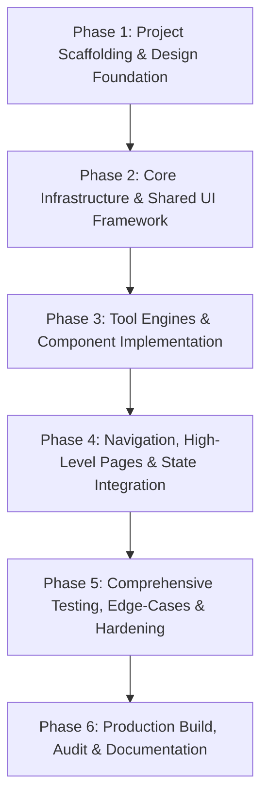

# DevTools Hub — Master Implementation Plan

## 1. Project Overview & Objectives

**DevTools Hub** is a production-grade, 100% client-side developer utility platform designed to deliver 12 high-utility tools within a cohesive, professional SaaS interface.

### Key Architectural Tenets
- **Zero Backend / Complete Privacy:** All computations occur strictly in-memory within the user's browser. No pasted code, tokens, or documents are ever sent to an external server.
- **Modern Angular Standalone:** Pure standalone component architecture using Angular Signals, modern router lazy-loading, and `OnPush` change detection.
- **SaaS Polish & Accessibility:** Designed with a refined developer palette (Primary `#3762EA`), light and dark themes, responsive layout, keyboard accessibility, and sub-second tool switching.

---

## 2. Dependency Strategy & Audit

### 2.1 Dependencies
| Package | Version | Purpose | Bundle Impact | Approval Status |
| :--- | :--- | :--- | :--- | :--- |
| `@angular/core`, `@angular/common`, `@angular/router` | ^19.0.0 / Current CLI | Core SPA Framework & Routing | Baseline | Approved |
| `tailwindcss`, `postcss`, `autoprefixer` | Latest Compatible | Design tokens, responsive utilities, dark mode | 0 KB runtime (Purged CSS) | Approved |
| `lucide-angular` | ^0.460.0 | Lightweight, consistent SVG icon set | Tree-shaken (~1-2 KB per icon) | Approved |
| `papaparse`, `@types/papaparse` | ^5.4.0 | Robust RFC 4180 CSV parsing and serialization | ~15 KB (isolated to CSV tools) | Approved |

### 2.2 Prohibited Dependencies
- ❌ No external backend frameworks (Node/Express, Nest, Python).
- ❌ No external auth providers or cloud databases (Firebase, Supabase, Auth0).
- ❌ No heavy monolithic component libraries (Angular Material, PrimeNG) that impose unwanted style overrides and bundle bloat.
- ❌ No deprecated or unsafe libraries (e.g. `crypto-js` — native `SubtleCrypto` is used instead).

---

## 3. Phased Implementation Roadmap



### Phase 1: Workspace Initialization & Design System Setup
- Initialize Angular application with standalone mode, routing, and strict typing (`ng new devtools-hub --standalone --routing --strict --style=css`).
- Configure Tailwind CSS:
  - Configure `tailwind.config.js` with brand blue `#3762EA`, neutral slate scales, and `darkMode: 'class'`.
  - Establish base typography, custom scrollbars, and monospace code pane styling.
- Install `lucide-angular` and setup icon imports.
- Validate workspace compilation and development server hot-reloading.

### Phase 2: Core Infrastructure & Shared Component Framework
- Establish Core Data Models:
  - `ToolMetadata`, `ToolCategory`, `ToolStatus` in `src/app/core/models/tool.model.ts`.
  - Canonical tool directory in `src/app/core/data/tools.data.ts`.
- Implement Core Services (Signal-driven):
  - `ThemeService`: Light/Dark/System modes with `localStorage` persistence.
  - `FavoritesService`: Reactive bookmarking of favorite tools.
  - `RecentToolsService`: Recents stack for quick navigation.
  - `ToolRegistryService`: Single source of truth with real-time fuzzy/keyword search.
  - `ToastService`: Non-blocking user feedback banners.
- Build Shared UI Primitives:
  - `ToolLayoutComponent`: Standard wrapper with breadcrumb, header, actions, and slots.
  - `ToolHeaderComponent`: Title, category badge, favorite toggle, sample/clear buttons.
  - `CodePaneComponent`: Dual-pane editor with line numbers, byte counters, and drag-and-drop.
  - `CopyButtonComponent` & `DownloadButtonComponent`: Clipboard and Blob downloaders.
  - `ErrorAlertComponent` & `StatusBadgeComponent`: Diagnostics and status indicators.

### Phase 3: Tool Engine & Component Development (Batched Execution)

#### Batch A: Formatters & Validators
1. **JSON Formatter:**
   - Pretty-print (2 spaces, 4 spaces, tabs) and minification.
   - Size comparison metrics and compression ratio.
   - Syntax error highlighting with character/line coordinates.
2. **JSON Validator:**
   - RFC 8259 syntax validation without silent mutations.
   - Structural metrics (object depth, total keys, array lengths).
   - Clear visual status banner and diagnostic inspector.

#### Batch B: Data Converters
3. **JSON to CSV:**
   - JSON array / object conversion via `Papa.unparse`.
   - Nested object flattening strategy (`a.b.c`) vs JSON stringification option.
   - Interactive table preview and raw CSV export.
4. **CSV to JSON:**
   - Parsing via `Papa.parse` with delimiter auto-detection and quote escaping.
   - Dynamic type conversion toggle (numbers/booleans).
   - Row-level parse warnings and output download.

#### Batch C: Encoders & Decoders
5. **Base64 Encoder / Decoder:**
   - Modern UTF-8 safe encoding/decoding using `TextEncoder`/`TextDecoder`.
   - URL-safe Base64 toggle (RFC 4648).
   - Strict avoidance of deprecated `escape`/`unescape`.
6. **URL Encoder / Decoder:**
   - Component vs Full URL mode (`encodeURIComponent` vs `encodeURI`).
   - Query parameter breakdown and inspection table.
   - Educational guide on reserved URL characters.

#### Batch D: Cryptography & Security
7. **JWT Decoder:**
   - Client-side header and payload decoding.
   - Visual claims inspector and expiration countdown (`exp`, `iat`, `nbf`).
   - Unverified signature disclaimer and zero-network guarantee.
8. **SHA-256 Hash Generator:**
   - Browser-native `window.crypto.subtle.digest()`.
   - Hex digest output with lowercase/uppercase toggles.
   - Educational explainer (one-way hashing vs encryption; salt requirements).

#### Batch E: Generators & Utilities
9. **UUID Generator:**
   - RFC 4122 v4 generator using `crypto.randomUUID()`.
   - Multi-UUID bulk generation (1-100), case and hyphen toggles.
10. **Timestamp Converter:**
    - Epoch seconds / milliseconds to UTC, Local, ISO-8601, and relative time.
    - Date picker to Epoch timestamp conversion.
    - Live ticking Unix epoch clock.
11. **Regex Tester:**
    - Regex pattern and flags evaluator with live match counts.
    - Matched span highlighting with alternating colors.
    - ReDoS safety constraints and match limits.
12. **Cron Builder:**
    - Visual segmented builder for standard 5-field cron.
    - Plain English translation engine.
    - Presets and timezone execution guidance.

### Phase 4: Application Shell, High-Level Pages & Routing
- Build `AppShellComponent`:
  - Responsive collapsible sidebar with categorized tool navigation and favorites count.
  - Top navigation bar with theme switcher, global `Ctrl+K` search command dialog, and quick links.
- Implement Portal Pages:
  - `DashboardComponent`: Quick-access tool grid, recent tools, favorites, and security stats.
  - `AllToolsComponent`: Filterable catalog with search bar, category tabs, and status badges.
  - `FavoritesComponent`: Focused view of starred utilities.
  - `AboutComponent`: Architectural explanation, 100% local processing guarantee, and privacy audit.
  - `NotFoundComponent`: Polished 404 recovery page.
- Configure Lazy-Loaded Routes with dynamic page titles.

### Phase 5: Verification, Testing & Edge-Case Hardening
- Execute comprehensive test suite:
  - Unit tests for all pure engine files (`*.engine.spec.ts`).
  - Unicode character tests (emojis, CJK, multi-byte sequences) for Base64 and encoders.
  - Large input benchmarking (5 MB files in JSON and CSV converters).
  - Malformed input tests (broken JSON, corrupted Base64, incomplete JWTs, invalid regex).
- Usability and accessibility audit:
  - Responsive layout checks across mobile (375px), tablet (768px), and desktop (1440px).
  - Keyboard navigation for command palette, inputs, and copy buttons.
  - Contrast check for dark and light themes against WCAG AA standards.

### Phase 6: Production Build & Deployment Readiness
- Run production optimization build: `ng build --configuration production`.
- Verify bundle sizes, chunk separation, and tree-shaking efficiency.
- Final documentation and user guide verification.

---

## 4. Risk Assessment & Mitigation Matrix

| Risk Event | Severity | Likelihood | Mitigation Strategy |
| :--- | :--- | :--- | :--- |
| **Large Text / File UI Freezes** | Medium | Medium | Implement text size warnings (> 2MB), enforce max-match limits in Regex tester (5,000 matches), and use deferred processing or Web Workers for CPU-bound tasks. |
| **Unicode Corruption in Base64** | High | Low | Enforce native `TextEncoder` and `TextDecoder('utf-8', { fatal: true })` instead of deprecated `escape`/`unescape` or naive byte loops. |
| **Catastrophic Backtracking in Regex (ReDoS)** | High | Medium | Add clear safety disclaimers, sanitize patterns, limit test string length to 100,000 chars, and trap infinite zero-length match loops. |
| **Insecure Cryptographic APIs** | High | Low | Strictly enforce `crypto.subtle` and `crypto.randomUUID()`. Verify secure context (`window.isSecureContext`) and display clear guidance if accessed over insecure HTTP. |
| **Data Leakage Concerns** | High | Low | Complete architectural absence of outbound HTTP requests. Ephemeral memory-only input buffers; zero persistence of user code in `localStorage`. |
| **Inconsistent Timezone Displays** | Medium | Medium | Explicitly label all timestamps with UTC vs Local Timezone offsets (e.g. `UTC+05:00`). Clearly state that Cron expressions require execution timezone context. |

---

## 5. Testing Strategy

```text
Testing Pyramid:
┌───────────────────────────────────────────────┐
│              E2E / Workflow Checks            │  - Routing, theme persistence, search dialog
├───────────────────────────────────────────────┤
│            Component & UI Behavior            │  - Copy buttons, sample loaders, error banners
├───────────────────────────────────────────────┤
│        Pure Engine Unit Tests (Target 100%)    │  - All 12 tool engines, edge cases, unicode
└───────────────────────────────────────────────┘
```

### 5.1 Unit Test Coverage Criteria
Each of the 12 engines must pass unit tests verifying:
1. **Happy Path:** Standard inputs producing deterministic outputs.
2. **Empty Inputs:** Empty strings, whitespace-only inputs, nullish values handled gracefully without throwing unhandled exceptions.
3. **Invalid / Malformed Inputs:** Syntax errors properly trapped with structured error objects.
4. **Unicode & Boundary Tests:** Non-ASCII characters (e.g. `Hello 🌍 世界`, RTL strings, byte-order marks).
5. **Special Characters:** Quotes, unescaped delimiters, special regex metacharacters.

---

## 6. Acceptance Criteria

### Application-Wide Criteria
- [ ] Application compiles in production mode with zero errors and zero circular dependencies.
- [ ] 100% of data processing occurs in the browser sandbox; zero HTTP calls made during tool operations.
- [ ] Light and dark themes switch instantly without layout shift and persist across page reloads.
- [ ] Responsive navigation works smoothly across mobile (< 640px), tablet (640-1024px), and desktop (> 1024px).
- [ ] Global search command dialog (`Ctrl+K` / `Cmd+K`) finds tools by name, description, category, and keywords.
- [ ] Favorites can be added/removed from any tool page or catalog card and persist in `localStorage`.

### Tool-Specific Criteria
- [ ] **JSON Formatter:** Formats with 2 spaces, 4 spaces, and tabs; minifies cleanly; highlights syntax errors with line/column coordinates.
- [ ] **JSON Validator:** Accurately reports valid vs invalid JSON; shows detailed error snippet; does not mutate input.
- [ ] **JSON to CSV:** Converts arrays of objects; provides flattening for nested objects; generates compliant CSV with table preview.
- [ ] **CSV to JSON:** Safely parses diverse delimiters, escaped quotes, and newlines; supports dynamic typing toggle.
- [ ] **Base64:** Correctly encodes/decodes complex UTF-8 strings and emojis; supports standard and URL-safe modes.
- [ ] **URL Encoder:** Distinguishes between component and full URL encoding; provides parsed query parameter breakdown.
- [ ] **JWT Decoder:** Extracts header and payload cleanly; displays expiration state (active countdown / expired); warns about unverified signatures.
- [ ] **UUID Generator:** Generates compliant v4 UUIDs using `crypto.randomUUID()`; supports batch generation up to 100 with formatting toggles.
- [ ] **Timestamp Converter:** Accurately converts between epoch seconds/milliseconds and UTC/local dates; displays live ticking current epoch.
- [ ] **Regex Tester:** Highlights matches in text; displays match indices and groups; handles invalid regex safely.
- [ ] **Cron Builder:** Synchronizes visual dropdowns with 5-field syntax; provides plain-English explanation; includes common presets.
- [ ] **SHA-256:** Produces correct 64-character hex digests using `crypto.subtle`; provides educational context on one-way hashing vs encryption.

